
<a href="https://dishank25.github.io/Dishank25/"><picture>
  <source media="(max-width: 600px)" srcset="https://raw.githubusercontent.com/Dishank25/Dishank25/2a100f4d9834131c5c129b0d8cfeea1d2d21182d/assets/observatory-breathing-mobile.svg">
  
</picture></a>

<a href="https://github.com/Dishank25/abyssal-portfolio"><picture><source media="(max-width: 600px)" srcset="https://raw.githubusercontent.com/Dishank25/Dishank25/main/assets/overview/featured-stack-360-f0a5b5ae15.svg"><source media="(max-width: 959px)" srcset="https://raw.githubusercontent.com/Dishank25/Dishank25/main/assets/overview/featured-stack-660-2f42cbadb0.svg"><source media="(max-width: 1099px)" srcset="https://raw.githubusercontent.com/Dishank25/Dishank25/main/assets/overview/featured-row-592-1955ed0897.svg"><source media="(max-width: 1219px)" srcset="https://raw.githubusercontent.com/Dishank25/Dishank25/main/assets/overview/featured-row-700-d362641c47.svg"><source media="(max-width: 1279px)" srcset="https://raw.githubusercontent.com/Dishank25/Dishank25/main/assets/overview/featured-row-792-0d1eb55874.svg"></picture></a>

<a href="https://dishank25.github.io/Dishank25/#about"><picture><source media="(max-width: 600px)" srcset="https://raw.githubusercontent.com/Dishank25/Dishank25/main/assets/overview/about-stack-360-0f5317ff4b.svg"><source media="(max-width: 959px)" srcset="https://raw.githubusercontent.com/Dishank25/Dishank25/main/assets/overview/about-stack-660-a667e4926e.svg"><source media="(max-width: 1099px)" srcset="https://raw.githubusercontent.com/Dishank25/Dishank25/main/assets/overview/about-row-592-fa0f01a051.svg"><source media="(max-width: 1219px)" srcset="https://raw.githubusercontent.com/Dishank25/Dishank25/main/assets/overview/about-row-700-5274b3d85a.svg"><source media="(max-width: 1279px)" srcset="https://raw.githubusercontent.com/Dishank25/Dishank25/main/assets/overview/about-row-792-5a1be59659.svg">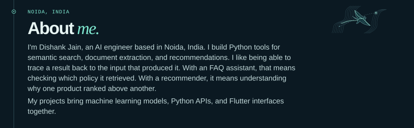</picture></a>

<a href="https://dishank25.github.io/Dishank25/#work"><picture><source media="(max-width: 600px)" srcset="https://raw.githubusercontent.com/Dishank25/Dishank25/main/assets/overview/selected-work-stack-360-c8a27d2dbc.svg"><source media="(max-width: 959px)" srcset="https://raw.githubusercontent.com/Dishank25/Dishank25/main/assets/overview/selected-work-stack-660-a28bc86574.svg"><source media="(max-width: 1099px)" srcset="https://raw.githubusercontent.com/Dishank25/Dishank25/main/assets/overview/selected-work-row-592-bdabf7314f.svg"><source media="(max-width: 1219px)" srcset="https://raw.githubusercontent.com/Dishank25/Dishank25/main/assets/overview/selected-work-row-700-46bc6184a0.svg"><source media="(max-width: 1279px)" srcset="https://raw.githubusercontent.com/Dishank25/Dishank25/main/assets/overview/selected-work-row-792-2c0b27d7fd.svg"></picture></a>

<a href="https://dishank25.github.io/Dishank25/projects/pawsupport/"><picture><source media="(max-width: 600px)" srcset="https://raw.githubusercontent.com/Dishank25/Dishank25/main/assets/overview/pawsupport-stack-360-76d95be6e5.svg"><source media="(max-width: 959px)" srcset="https://raw.githubusercontent.com/Dishank25/Dishank25/main/assets/overview/pawsupport-stack-660-c48b066686.svg"><source media="(max-width: 1099px)" srcset="https://raw.githubusercontent.com/Dishank25/Dishank25/main/assets/overview/pawsupport-cell-296-f55ce76517.svg"><source media="(max-width: 1219px)" srcset="https://raw.githubusercontent.com/Dishank25/Dishank25/main/assets/overview/pawsupport-cell-350-cdbe8b2860.svg"><source media="(max-width: 1279px)" srcset="https://raw.githubusercontent.com/Dishank25/Dishank25/main/assets/overview/pawsupport-cell-396-13f1d6c812.svg">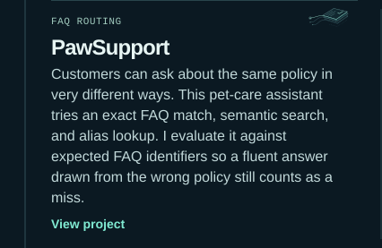</picture></a><a href="https://dishank25.github.io/Dishank25/projects/supportpilot/"><picture><source media="(max-width: 600px)" srcset="https://raw.githubusercontent.com/Dishank25/Dishank25/main/assets/overview/supportpilot-stack-360-d273f9cf30.svg"><source media="(max-width: 959px)" srcset="https://raw.githubusercontent.com/Dishank25/Dishank25/main/assets/overview/supportpilot-stack-660-6bc7061d70.svg"><source media="(max-width: 1099px)" srcset="https://raw.githubusercontent.com/Dishank25/Dishank25/main/assets/overview/supportpilot-cell-296-d38887cbaa.svg"><source media="(max-width: 1219px)" srcset="https://raw.githubusercontent.com/Dishank25/Dishank25/main/assets/overview/supportpilot-cell-350-e276f2fded.svg"><source media="(max-width: 1279px)" srcset="https://raw.githubusercontent.com/Dishank25/Dishank25/main/assets/overview/supportpilot-cell-396-0c9328ca48.svg">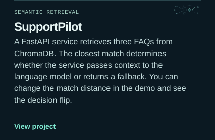</picture></a>

<a href="https://dishank25.github.io/Dishank25/projects/veterinary-records/"><picture><source media="(max-width: 600px)" srcset="https://raw.githubusercontent.com/Dishank25/Dishank25/main/assets/overview/veterinary-records-stack-360-a331cea4fe.svg"><source media="(max-width: 959px)" srcset="https://raw.githubusercontent.com/Dishank25/Dishank25/main/assets/overview/veterinary-records-stack-660-4b76f8ef63.svg"><source media="(max-width: 1099px)" srcset="https://raw.githubusercontent.com/Dishank25/Dishank25/main/assets/overview/veterinary-records-cell-296-4ce426ef9e.svg"><source media="(max-width: 1219px)" srcset="https://raw.githubusercontent.com/Dishank25/Dishank25/main/assets/overview/veterinary-records-cell-350-994b8c964f.svg"><source media="(max-width: 1279px)" srcset="https://raw.githubusercontent.com/Dishank25/Dishank25/main/assets/overview/veterinary-records-cell-396-dba74c51ce.svg">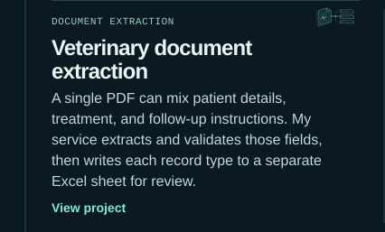</picture></a><a href="https://dishank25.github.io/Dishank25/projects/recommendations/"><picture><source media="(max-width: 600px)" srcset="https://raw.githubusercontent.com/Dishank25/Dishank25/main/assets/overview/recommendations-stack-360-39fc5dcf4a.svg"><source media="(max-width: 959px)" srcset="https://raw.githubusercontent.com/Dishank25/Dishank25/main/assets/overview/recommendations-stack-660-41cb92f1ed.svg"><source media="(max-width: 1099px)" srcset="https://raw.githubusercontent.com/Dishank25/Dishank25/main/assets/overview/recommendations-cell-296-d84bac7194.svg"><source media="(max-width: 1219px)" srcset="https://raw.githubusercontent.com/Dishank25/Dishank25/main/assets/overview/recommendations-cell-350-d14f9b4131.svg"><source media="(max-width: 1279px)" srcset="https://raw.githubusercontent.com/Dishank25/Dishank25/main/assets/overview/recommendations-cell-396-9328a98c44.svg">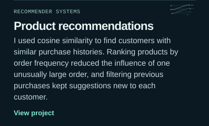</picture></a>

<a href="https://dishank25.github.io/Dishank25/projects/breed-identification/"><picture><source media="(max-width: 600px)" srcset="https://raw.githubusercontent.com/Dishank25/Dishank25/main/assets/overview/breed-identification-stack-360-60fc8e5595.svg"><source media="(max-width: 959px)" srcset="https://raw.githubusercontent.com/Dishank25/Dishank25/main/assets/overview/breed-identification-stack-660-5e1445b8f4.svg"><source media="(max-width: 1099px)" srcset="https://raw.githubusercontent.com/Dishank25/Dishank25/main/assets/overview/breed-identification-row-592-52d2f22540.svg"><source media="(max-width: 1219px)" srcset="https://raw.githubusercontent.com/Dishank25/Dishank25/main/assets/overview/breed-identification-row-700-5e72a17769.svg"><source media="(max-width: 1279px)" srcset="https://raw.githubusercontent.com/Dishank25/Dishank25/main/assets/overview/breed-identification-row-792-591cf58b75.svg">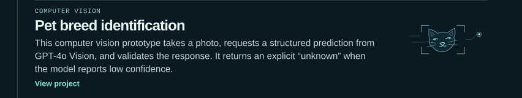</picture></a>

<a href="https://dishank25.github.io/Dishank25/#work"><picture><source media="(max-width: 600px)" srcset="https://raw.githubusercontent.com/Dishank25/Dishank25/main/assets/overview/more-projects-stack-360-496e55e106.svg"><source media="(max-width: 959px)" srcset="https://raw.githubusercontent.com/Dishank25/Dishank25/main/assets/overview/more-projects-stack-660-9a5a1ccdf1.svg"><source media="(max-width: 1099px)" srcset="https://raw.githubusercontent.com/Dishank25/Dishank25/main/assets/overview/more-projects-row-592-8467296380.svg"><source media="(max-width: 1219px)" srcset="https://raw.githubusercontent.com/Dishank25/Dishank25/main/assets/overview/more-projects-row-700-7a0093eee5.svg"><source media="(max-width: 1279px)" srcset="https://raw.githubusercontent.com/Dishank25/Dishank25/main/assets/overview/more-projects-row-792-0f4ace8d35.svg"></picture></a>

<a href="https://dishank25.github.io/Dishank25/projects/abyssal-portfolio/"><picture><source media="(max-width: 600px)" srcset="https://raw.githubusercontent.com/Dishank25/Dishank25/main/assets/overview/abyssal-portfolio-stack-360-d6920fc8d1.svg"><source media="(max-width: 959px)" srcset="https://raw.githubusercontent.com/Dishank25/Dishank25/main/assets/overview/abyssal-portfolio-stack-660-c1cd36a61f.svg"><source media="(max-width: 1099px)" srcset="https://raw.githubusercontent.com/Dishank25/Dishank25/main/assets/overview/abyssal-portfolio-cell-296-9d52633239.svg"><source media="(max-width: 1219px)" srcset="https://raw.githubusercontent.com/Dishank25/Dishank25/main/assets/overview/abyssal-portfolio-cell-350-ddf85d2c76.svg"><source media="(max-width: 1279px)" srcset="https://raw.githubusercontent.com/Dishank25/Dishank25/main/assets/overview/abyssal-portfolio-cell-396-b42fc6faf8.svg">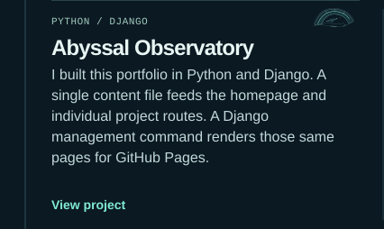</picture></a><a href="https://dishank25.github.io/Dishank25/projects/job-portal/"><picture><source media="(max-width: 600px)" srcset="https://raw.githubusercontent.com/Dishank25/Dishank25/main/assets/overview/job-portal-stack-360-15ea8af2b7.svg"><source media="(max-width: 959px)" srcset="https://raw.githubusercontent.com/Dishank25/Dishank25/main/assets/overview/job-portal-stack-660-0ac2c39932.svg"><source media="(max-width: 1099px)" srcset="https://raw.githubusercontent.com/Dishank25/Dishank25/main/assets/overview/job-portal-cell-296-4262ef79a1.svg"><source media="(max-width: 1219px)" srcset="https://raw.githubusercontent.com/Dishank25/Dishank25/main/assets/overview/job-portal-cell-350-f11ab47901.svg"><source media="(max-width: 1279px)" srcset="https://raw.githubusercontent.com/Dishank25/Dishank25/main/assets/overview/job-portal-cell-396-429f3d8c2b.svg">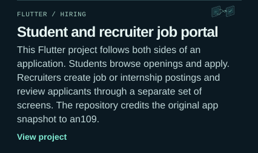</picture></a>

<a href="https://dishank25.github.io/Dishank25/projects/job-discovery/"><picture><source media="(max-width: 600px)" srcset="https://raw.githubusercontent.com/Dishank25/Dishank25/main/assets/overview/job-discovery-stack-360-7e893fcb18.svg"><source media="(max-width: 959px)" srcset="https://raw.githubusercontent.com/Dishank25/Dishank25/main/assets/overview/job-discovery-stack-660-181ebe00d7.svg"><source media="(max-width: 1099px)" srcset="https://raw.githubusercontent.com/Dishank25/Dishank25/main/assets/overview/job-discovery-cell-296-7f3866a0bf.svg"><source media="(max-width: 1219px)" srcset="https://raw.githubusercontent.com/Dishank25/Dishank25/main/assets/overview/job-discovery-cell-350-1df54aaa21.svg"><source media="(max-width: 1279px)" srcset="https://raw.githubusercontent.com/Dishank25/Dishank25/main/assets/overview/job-discovery-cell-396-f9fa6220d4.svg">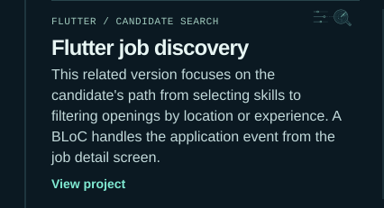</picture></a><a href="https://dishank25.github.io/Dishank25/projects/terminal-tic-tac-toe/"><picture><source media="(max-width: 600px)" srcset="https://raw.githubusercontent.com/Dishank25/Dishank25/main/assets/overview/terminal-tic-tac-toe-stack-360-39afcbad17.svg"><source media="(max-width: 959px)" srcset="https://raw.githubusercontent.com/Dishank25/Dishank25/main/assets/overview/terminal-tic-tac-toe-stack-660-7a97c93f27.svg"><source media="(max-width: 1099px)" srcset="https://raw.githubusercontent.com/Dishank25/Dishank25/main/assets/overview/terminal-tic-tac-toe-cell-296-7c76eb3318.svg"><source media="(max-width: 1219px)" srcset="https://raw.githubusercontent.com/Dishank25/Dishank25/main/assets/overview/terminal-tic-tac-toe-cell-350-f7051a121b.svg"><source media="(max-width: 1279px)" srcset="https://raw.githubusercontent.com/Dishank25/Dishank25/main/assets/overview/terminal-tic-tac-toe-cell-396-a072fc71f9.svg">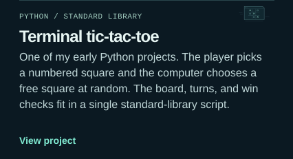</picture></a>

<a href="https://dishank25.github.io/Dishank25/#skills"><picture><source media="(max-width: 600px)" srcset="https://raw.githubusercontent.com/Dishank25/Dishank25/main/assets/overview/skills-stack-360-95783ba054.svg"><source media="(max-width: 959px)" srcset="https://raw.githubusercontent.com/Dishank25/Dishank25/main/assets/overview/skills-stack-660-09ef384d6d.svg"><source media="(max-width: 1099px)" srcset="https://raw.githubusercontent.com/Dishank25/Dishank25/main/assets/overview/skills-row-592-d1f0a1cff0.svg"><source media="(max-width: 1219px)" srcset="https://raw.githubusercontent.com/Dishank25/Dishank25/main/assets/overview/skills-row-700-109db2287b.svg"><source media="(max-width: 1279px)" srcset="https://raw.githubusercontent.com/Dishank25/Dishank25/main/assets/overview/skills-row-792-04c447c09d.svg">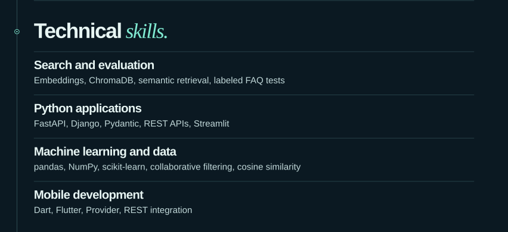</picture></a>

<a href="https://dishank25.github.io/Dishank25/#experience"><picture><source media="(max-width: 600px)" srcset="https://raw.githubusercontent.com/Dishank25/Dishank25/main/assets/overview/experience-stack-360-b4a095e74f.svg"><source media="(max-width: 959px)" srcset="https://raw.githubusercontent.com/Dishank25/Dishank25/main/assets/overview/experience-stack-660-4194cbe5f8.svg"><source media="(max-width: 1099px)" srcset="https://raw.githubusercontent.com/Dishank25/Dishank25/main/assets/overview/experience-row-592-5503f471c1.svg"><source media="(max-width: 1219px)" srcset="https://raw.githubusercontent.com/Dishank25/Dishank25/main/assets/overview/experience-row-700-ea3af6a1b9.svg"><source media="(max-width: 1279px)" srcset="https://raw.githubusercontent.com/Dishank25/Dishank25/main/assets/overview/experience-row-792-20ec22536d.svg"></picture></a>

<a href="https://dishank25.github.io/Dishank25/#experience"><picture><source media="(max-width: 600px)" srcset="https://raw.githubusercontent.com/Dishank25/Dishank25/main/assets/overview/education-stack-360-6af30c27b8.svg"><source media="(max-width: 959px)" srcset="https://raw.githubusercontent.com/Dishank25/Dishank25/main/assets/overview/education-stack-660-db34ba7069.svg"><source media="(max-width: 1099px)" srcset="https://raw.githubusercontent.com/Dishank25/Dishank25/main/assets/overview/education-row-592-ece22cfb19.svg"><source media="(max-width: 1219px)" srcset="https://raw.githubusercontent.com/Dishank25/Dishank25/main/assets/overview/education-row-700-f29b589632.svg"><source media="(max-width: 1279px)" srcset="https://raw.githubusercontent.com/Dishank25/Dishank25/main/assets/overview/education-row-792-8784c9f747.svg"></picture></a>

<a href="https://www.linkedin.com/in/dishankjain25/"><picture><source media="(max-width: 600px)" srcset="https://raw.githubusercontent.com/Dishank25/Dishank25/main/assets/overview/connect-stack-360-043f399cbb.svg"><source media="(max-width: 959px)" srcset="https://raw.githubusercontent.com/Dishank25/Dishank25/main/assets/overview/connect-stack-660-8e87261a44.svg"><source media="(max-width: 1099px)" srcset="https://raw.githubusercontent.com/Dishank25/Dishank25/main/assets/overview/connect-row-592-e1be1ac2a2.svg"><source media="(max-width: 1219px)" srcset="https://raw.githubusercontent.com/Dishank25/Dishank25/main/assets/overview/connect-row-700-1beb879115.svg"><source media="(max-width: 1279px)" srcset="https://raw.githubusercontent.com/Dishank25/Dishank25/main/assets/overview/connect-row-792-b4b683d03d.svg"></picture></a>

<a href="https://github.com/Dishank25/Dishank25/blob/main/PROFILE.md"><picture><source media="(max-width: 600px)" srcset="https://raw.githubusercontent.com/Dishank25/Dishank25/main/assets/overview/text-stack-360-3e27793d18.svg"><source media="(max-width: 959px)" srcset="https://raw.githubusercontent.com/Dishank25/Dishank25/main/assets/overview/text-stack-660-b1a622cfd3.svg"><source media="(max-width: 1099px)" srcset="https://raw.githubusercontent.com/Dishank25/Dishank25/main/assets/overview/text-row-592-0b5978d96e.svg"><source media="(max-width: 1219px)" srcset="https://raw.githubusercontent.com/Dishank25/Dishank25/main/assets/overview/text-row-700-0fd8745cda.svg"><source media="(max-width: 1279px)" srcset="https://raw.githubusercontent.com/Dishank25/Dishank25/main/assets/overview/text-row-792-54f2122d58.svg"></picture></a>

