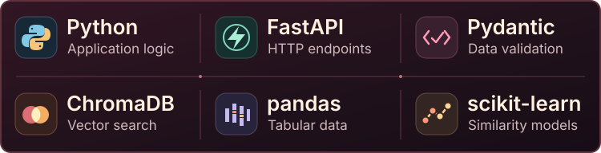

<picture>
  <source media="(prefers-reduced-motion: reduce)" srcset="assets/identity-still.svg">
  
</picture>

[`~/whoami`](#about) · [`~/projects`](#featured-projects) · [`~/toolbox`](#toolbox) · [LinkedIn ↗](https://www.linkedin.com/in/dishankjain25/)

## About

I’m Dishank. I build Python applications for semantic search, document extraction, and product recommendations. In my support assistants, I test which source answers a question and when the system should ask for help.

## Featured projects

### [PawSupport](https://github.com/Dishank25/ZiglyPawSupport)

PawSupport matches pet-care questions to approved FAQs. Its offline tests catch replies that sound right but draw on the wrong source.

[Read the evaluation code](https://github.com/Dishank25/ZiglyPawSupport/blob/main/evaluation/run_evaluation.py) · [Explore the labeled questions](https://github.com/Dishank25/ZiglyPawSupport/blob/main/evaluation/test_cases_v1_strict.json)

### [SupportPilot](https://github.com/Dishank25/supportpilot)

SupportPilot retrieves three FAQ candidates from ChromaDB and returns a fallback when the strongest match falls below its confidence threshold.

[Trace a chat request](https://github.com/Dishank25/supportpilot/blob/main/main.py) · [Inspect the confidence calculation](https://github.com/Dishank25/supportpilot/blob/main/agents/retrieval_agent.py)

## Toolbox

<strong>Document extraction, recommendations, and computer vision</strong>

- **Veterinary records.** A FastAPI service extracts treatment and follow-up fields from PDFs, validates them, and writes structured Excel sheets.
- **Product recommendations.** A collaborative filter uses cosine similarity to find customers with similar purchase histories and recommends items they haven’t bought.
- **Pet breed identification.** A GPT-4o Vision prototype validates its JSON output and returns an unknown result for low-confidence predictions.

<strong>Flutter apps and Python game</strong>

- [Job discovery in Flutter](https://github.com/Dishank25/rishabh6363-jobflutter-448f346c9d38) — Candidate onboarding, search filters, and job applications.
- [Job Portal](https://github.com/Dishank25/Job-Portal) — Separate student and recruiter flows for applying to jobs and posting openings.
- [Tic-tac-toe](https://github.com/Dishank25/python_project) — A Python terminal game against a computer opponent that picks an empty square at random.

