
<a href="https://dishank25.github.io/Dishank25/"><picture><source media="(max-width: 600px)" srcset="https://raw.githubusercontent.com/Dishank25/Dishank25/2a100f4d9834131c5c129b0d8cfeea1d2d21182d/assets/observatory-breathing-mobile.svg 0.35x" width="100%"><source media="(max-width: 1023px)" srcset="https://raw.githubusercontent.com/Dishank25/Dishank25/main/assets/observatory-breathing.svg 0.8x" width="100%"><source media="(max-width: 1249px)" srcset="https://raw.githubusercontent.com/Dishank25/Dishank25/main/assets/observatory-breathing.svg 1.57894737x" width="100%"><source srcset="https://raw.githubusercontent.com/Dishank25/Dishank25/main/assets/observatory-breathing.svg 1.2x" width="100%"></picture></a>

<a href="https://dishank25.github.io/Dishank25/projects/abyssal-portfolio/"><picture><source media="(max-width: 440px)" srcset="https://raw.githubusercontent.com/Dishank25/Dishank25/main/assets/overview/featured-360-b27fb6f126.svg" width="100%"><source media="(max-width: 600px)" srcset="https://raw.githubusercontent.com/Dishank25/Dishank25/main/assets/overview/featured-475-a6040c2f15.svg" width="100%"><source media="(max-width: 1023px)" srcset="https://raw.githubusercontent.com/Dishank25/Dishank25/main/assets/overview/featured-660-27630b425f.svg" width="100%"><source media="(max-width: 1249px)" srcset="https://raw.githubusercontent.com/Dishank25/Dishank25/main/assets/overview/featured-800-e23cfa8d22.svg" width="100%"><source srcset="https://raw.githubusercontent.com/Dishank25/Dishank25/main/assets/overview/featured-920-7a5385e996.svg" width="100%">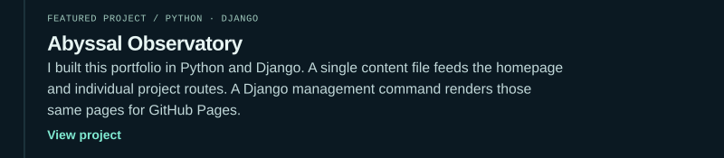</picture></a>

<a href="https://dishank25.github.io/Dishank25/#about"><picture><source media="(max-width: 440px)" srcset="https://raw.githubusercontent.com/Dishank25/Dishank25/main/assets/overview/about-360-7f4e567e18.svg" width="100%"><source media="(max-width: 600px)" srcset="https://raw.githubusercontent.com/Dishank25/Dishank25/main/assets/overview/about-475-e13709cba7.svg" width="100%"><source media="(max-width: 1023px)" srcset="https://raw.githubusercontent.com/Dishank25/Dishank25/main/assets/overview/about-660-57b2d47fae.svg" width="100%"><source media="(max-width: 1249px)" srcset="https://raw.githubusercontent.com/Dishank25/Dishank25/main/assets/overview/about-800-55620c5e02.svg" width="100%"><source srcset="https://raw.githubusercontent.com/Dishank25/Dishank25/main/assets/overview/about-920-8e222f6d48.svg" width="100%">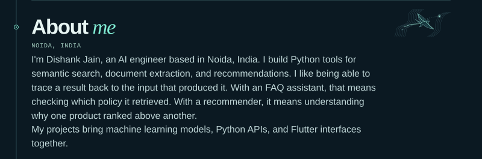</picture></a>

<a href="https://dishank25.github.io/Dishank25/#work"><picture><source media="(max-width: 440px)" srcset="https://raw.githubusercontent.com/Dishank25/Dishank25/main/assets/overview/my-works-360-54def6f57d.svg" width="100%"><source media="(max-width: 600px)" srcset="https://raw.githubusercontent.com/Dishank25/Dishank25/main/assets/overview/my-works-475-2608d2d4f6.svg" width="100%"><source media="(max-width: 1023px)" srcset="https://raw.githubusercontent.com/Dishank25/Dishank25/main/assets/overview/my-works-660-10339c9cf7.svg" width="100%"><source media="(max-width: 1249px)" srcset="https://raw.githubusercontent.com/Dishank25/Dishank25/main/assets/overview/my-works-800-f74c0e7445.svg" width="100%"><source srcset="https://raw.githubusercontent.com/Dishank25/Dishank25/main/assets/overview/my-works-920-c5a8f32697.svg" width="100%"></picture></a>

<a href="https://dishank25.github.io/Dishank25/projects/pawsupport/"><picture><source media="(max-width: 440px)" srcset="https://raw.githubusercontent.com/Dishank25/Dishank25/main/assets/overview/pawsupport-360-stack-f38496572f.svg" width="100%"><source media="(max-width: 600px)" srcset="https://raw.githubusercontent.com/Dishank25/Dishank25/main/assets/overview/pawsupport-475-stack-2762331b77.svg" width="100%"><source media="(max-width: 1023px)" srcset="https://raw.githubusercontent.com/Dishank25/Dishank25/main/assets/overview/pawsupport-660-stack-ad7ce7ee33.svg" width="100%"><source media="(max-width: 1249px)" srcset="https://raw.githubusercontent.com/Dishank25/Dishank25/main/assets/overview/pawsupport-800-column-79c8e0ca28.svg" width="50%"><source srcset="https://raw.githubusercontent.com/Dishank25/Dishank25/main/assets/overview/pawsupport-920-column-112ce3f554.svg" width="50%">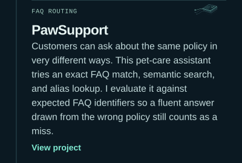</picture></a><a href="https://dishank25.github.io/Dishank25/projects/supportpilot/"><picture><source media="(max-width: 440px)" srcset="https://raw.githubusercontent.com/Dishank25/Dishank25/main/assets/overview/supportpilot-360-stack-e7d4fa6a89.svg" width="100%"><source media="(max-width: 600px)" srcset="https://raw.githubusercontent.com/Dishank25/Dishank25/main/assets/overview/supportpilot-475-stack-7a9acd3fd2.svg" width="100%"><source media="(max-width: 1023px)" srcset="https://raw.githubusercontent.com/Dishank25/Dishank25/main/assets/overview/supportpilot-660-stack-2a848f816b.svg" width="100%"><source media="(max-width: 1249px)" srcset="https://raw.githubusercontent.com/Dishank25/Dishank25/main/assets/overview/supportpilot-800-column-e3872a3083.svg" width="50%"><source srcset="https://raw.githubusercontent.com/Dishank25/Dishank25/main/assets/overview/supportpilot-920-column-1a7bc97020.svg" width="50%">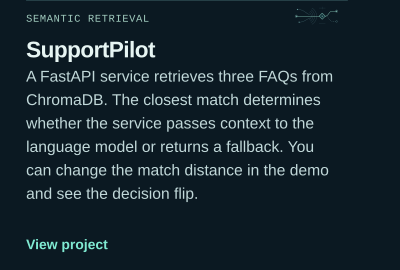</picture></a>

<a href="https://dishank25.github.io/Dishank25/projects/veterinary-records/"><picture><source media="(max-width: 440px)" srcset="https://raw.githubusercontent.com/Dishank25/Dishank25/main/assets/overview/veterinary-records-360-stack-2c5d166ab3.svg" width="100%"><source media="(max-width: 600px)" srcset="https://raw.githubusercontent.com/Dishank25/Dishank25/main/assets/overview/veterinary-records-475-stack-b84f5f4896.svg" width="100%"><source media="(max-width: 1023px)" srcset="https://raw.githubusercontent.com/Dishank25/Dishank25/main/assets/overview/veterinary-records-660-stack-9199d0f1c0.svg" width="100%"><source media="(max-width: 1249px)" srcset="https://raw.githubusercontent.com/Dishank25/Dishank25/main/assets/overview/veterinary-records-800-column-7072b5faf3.svg" width="50%"><source srcset="https://raw.githubusercontent.com/Dishank25/Dishank25/main/assets/overview/veterinary-records-920-column-cbd1e0ba5f.svg" width="50%">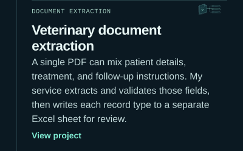</picture></a><a href="https://dishank25.github.io/Dishank25/projects/recommendations/"><picture><source media="(max-width: 440px)" srcset="https://raw.githubusercontent.com/Dishank25/Dishank25/main/assets/overview/recommendations-360-stack-d6c48b3578.svg" width="100%"><source media="(max-width: 600px)" srcset="https://raw.githubusercontent.com/Dishank25/Dishank25/main/assets/overview/recommendations-475-stack-26285d1ed2.svg" width="100%"><source media="(max-width: 1023px)" srcset="https://raw.githubusercontent.com/Dishank25/Dishank25/main/assets/overview/recommendations-660-stack-c695759d1e.svg" width="100%"><source media="(max-width: 1249px)" srcset="https://raw.githubusercontent.com/Dishank25/Dishank25/main/assets/overview/recommendations-800-column-43ab059c87.svg" width="50%"><source srcset="https://raw.githubusercontent.com/Dishank25/Dishank25/main/assets/overview/recommendations-920-column-a08c4cbe22.svg" width="50%">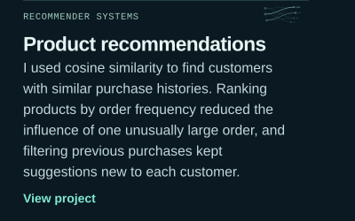</picture></a>

<a href="https://dishank25.github.io/Dishank25/projects/breed-identification/"><picture><source media="(max-width: 440px)" srcset="https://raw.githubusercontent.com/Dishank25/Dishank25/main/assets/overview/breed-identification-360-stack-bcf166fb70.svg" width="100%"><source media="(max-width: 600px)" srcset="https://raw.githubusercontent.com/Dishank25/Dishank25/main/assets/overview/breed-identification-475-stack-2d12ef5cf9.svg" width="100%"><source media="(max-width: 1023px)" srcset="https://raw.githubusercontent.com/Dishank25/Dishank25/main/assets/overview/breed-identification-660-stack-f54a471464.svg" width="100%"><source media="(max-width: 1249px)" srcset="https://raw.githubusercontent.com/Dishank25/Dishank25/main/assets/overview/breed-identification-800-column-a60cc1c7aa.svg" width="50%"><source srcset="https://raw.githubusercontent.com/Dishank25/Dishank25/main/assets/overview/breed-identification-920-column-58020bda7a.svg" width="50%">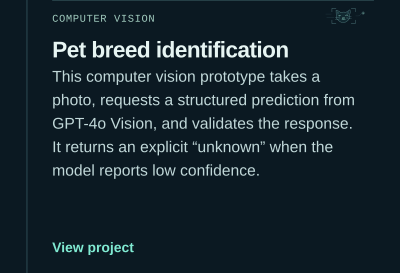</picture></a><a href="https://dishank25.github.io/Dishank25/projects/job-portal/"><picture><source media="(max-width: 440px)" srcset="https://raw.githubusercontent.com/Dishank25/Dishank25/main/assets/overview/job-portal-360-stack-ffbcb27786.svg" width="100%"><source media="(max-width: 600px)" srcset="https://raw.githubusercontent.com/Dishank25/Dishank25/main/assets/overview/job-portal-475-stack-2401afe3b4.svg" width="100%"><source media="(max-width: 1023px)" srcset="https://raw.githubusercontent.com/Dishank25/Dishank25/main/assets/overview/job-portal-660-stack-40c9e29add.svg" width="100%"><source media="(max-width: 1249px)" srcset="https://raw.githubusercontent.com/Dishank25/Dishank25/main/assets/overview/job-portal-800-column-eb0eaa63fb.svg" width="50%"><source srcset="https://raw.githubusercontent.com/Dishank25/Dishank25/main/assets/overview/job-portal-920-column-f1980a0504.svg" width="50%">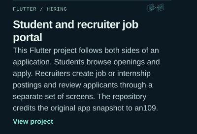</picture></a>

<a href="https://dishank25.github.io/Dishank25/projects/job-discovery/"><picture><source media="(max-width: 440px)" srcset="https://raw.githubusercontent.com/Dishank25/Dishank25/main/assets/overview/job-discovery-360-stack-4976e8428f.svg" width="100%"><source media="(max-width: 600px)" srcset="https://raw.githubusercontent.com/Dishank25/Dishank25/main/assets/overview/job-discovery-475-stack-530363b45f.svg" width="100%"><source media="(max-width: 1023px)" srcset="https://raw.githubusercontent.com/Dishank25/Dishank25/main/assets/overview/job-discovery-660-stack-b323cbb9a9.svg" width="100%"><source media="(max-width: 1249px)" srcset="https://raw.githubusercontent.com/Dishank25/Dishank25/main/assets/overview/job-discovery-800-column-21fe7361ca.svg" width="50%"><source srcset="https://raw.githubusercontent.com/Dishank25/Dishank25/main/assets/overview/job-discovery-920-column-b3fc866f9c.svg" width="50%">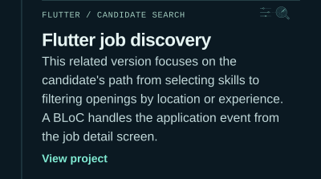</picture></a><a href="https://dishank25.github.io/Dishank25/projects/terminal-tic-tac-toe/"><picture><source media="(max-width: 440px)" srcset="https://raw.githubusercontent.com/Dishank25/Dishank25/main/assets/overview/terminal-tic-tac-toe-360-stack-a64e6b5074.svg" width="100%"><source media="(max-width: 600px)" srcset="https://raw.githubusercontent.com/Dishank25/Dishank25/main/assets/overview/terminal-tic-tac-toe-475-stack-947e22b8c0.svg" width="100%"><source media="(max-width: 1023px)" srcset="https://raw.githubusercontent.com/Dishank25/Dishank25/main/assets/overview/terminal-tic-tac-toe-660-stack-dc06b96a37.svg" width="100%"><source media="(max-width: 1249px)" srcset="https://raw.githubusercontent.com/Dishank25/Dishank25/main/assets/overview/terminal-tic-tac-toe-800-column-750cac444b.svg" width="50%"><source srcset="https://raw.githubusercontent.com/Dishank25/Dishank25/main/assets/overview/terminal-tic-tac-toe-920-column-5135018bfa.svg" width="50%">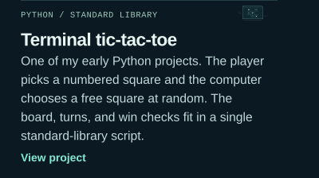</picture></a>

<a href="https://dishank25.github.io/Dishank25/#skills"><picture><source media="(max-width: 440px)" srcset="https://raw.githubusercontent.com/Dishank25/Dishank25/main/assets/overview/skills-360-3f5789fbaa.svg" width="100%"><source media="(max-width: 600px)" srcset="https://raw.githubusercontent.com/Dishank25/Dishank25/main/assets/overview/skills-475-0572a39cf9.svg" width="100%"><source media="(max-width: 1023px)" srcset="https://raw.githubusercontent.com/Dishank25/Dishank25/main/assets/overview/skills-660-dc76dae013.svg" width="100%"><source media="(max-width: 1249px)" srcset="https://raw.githubusercontent.com/Dishank25/Dishank25/main/assets/overview/skills-800-443365e886.svg" width="100%"><source srcset="https://raw.githubusercontent.com/Dishank25/Dishank25/main/assets/overview/skills-920-8325ed2d7c.svg" width="100%">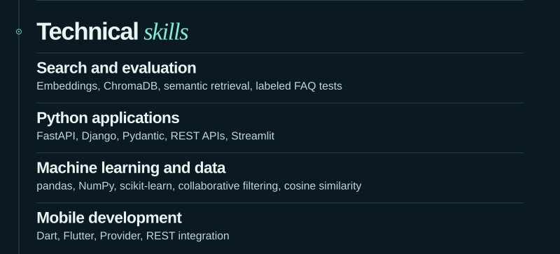</picture></a>

<a href="https://dishank25.github.io/Dishank25/#experience"><picture><source media="(max-width: 440px)" srcset="https://raw.githubusercontent.com/Dishank25/Dishank25/main/assets/overview/experience-360-c143e88ffc.svg" width="100%"><source media="(max-width: 600px)" srcset="https://raw.githubusercontent.com/Dishank25/Dishank25/main/assets/overview/experience-475-e09123e7be.svg" width="100%"><source media="(max-width: 1023px)" srcset="https://raw.githubusercontent.com/Dishank25/Dishank25/main/assets/overview/experience-660-8637336b29.svg" width="100%"><source media="(max-width: 1249px)" srcset="https://raw.githubusercontent.com/Dishank25/Dishank25/main/assets/overview/experience-800-269b3b9509.svg" width="100%"><source srcset="https://raw.githubusercontent.com/Dishank25/Dishank25/main/assets/overview/experience-920-298c268da9.svg" width="100%">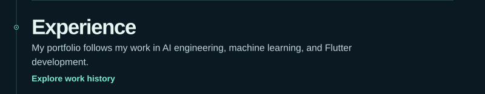</picture></a>

<a href="https://dishank25.github.io/Dishank25/#experience"><picture><source media="(max-width: 440px)" srcset="https://raw.githubusercontent.com/Dishank25/Dishank25/main/assets/overview/education-360-27b2e45fbd.svg" width="100%"><source media="(max-width: 600px)" srcset="https://raw.githubusercontent.com/Dishank25/Dishank25/main/assets/overview/education-475-03b12c2023.svg" width="100%"><source media="(max-width: 1023px)" srcset="https://raw.githubusercontent.com/Dishank25/Dishank25/main/assets/overview/education-660-b26ff7e793.svg" width="100%"><source media="(max-width: 1249px)" srcset="https://raw.githubusercontent.com/Dishank25/Dishank25/main/assets/overview/education-800-8f1b12e23a.svg" width="100%"><source srcset="https://raw.githubusercontent.com/Dishank25/Dishank25/main/assets/overview/education-920-5c34b9c715.svg" width="100%"></picture></a>

<a href="https://www.linkedin.com/in/dishankjain25/"><picture><source media="(max-width: 440px)" srcset="https://raw.githubusercontent.com/Dishank25/Dishank25/main/assets/overview/connect-360-fcdbfa56c8.svg" width="100%"><source media="(max-width: 600px)" srcset="https://raw.githubusercontent.com/Dishank25/Dishank25/main/assets/overview/connect-475-20e8465e32.svg" width="100%"><source media="(max-width: 1023px)" srcset="https://raw.githubusercontent.com/Dishank25/Dishank25/main/assets/overview/connect-660-dcc3842c27.svg" width="100%"><source media="(max-width: 1249px)" srcset="https://raw.githubusercontent.com/Dishank25/Dishank25/main/assets/overview/connect-800-2190be2861.svg" width="100%"><source srcset="https://raw.githubusercontent.com/Dishank25/Dishank25/main/assets/overview/connect-920-5df51b00d5.svg" width="100%"></picture></a>

<a href="https://github.com/Dishank25/Dishank25/blob/main/PROFILE.md"><picture><source media="(max-width: 440px)" srcset="https://raw.githubusercontent.com/Dishank25/Dishank25/main/assets/overview/text-360-38712028bc.svg" width="100%"><source media="(max-width: 600px)" srcset="https://raw.githubusercontent.com/Dishank25/Dishank25/main/assets/overview/text-475-3ee1e7507a.svg" width="100%"><source media="(max-width: 1023px)" srcset="https://raw.githubusercontent.com/Dishank25/Dishank25/main/assets/overview/text-660-4dfec2d73b.svg" width="100%"><source media="(max-width: 1249px)" srcset="https://raw.githubusercontent.com/Dishank25/Dishank25/main/assets/overview/text-800-c21499d4bd.svg" width="100%"><source srcset="https://raw.githubusercontent.com/Dishank25/Dishank25/main/assets/overview/text-920-2451a13018.svg" width="100%"></picture></a>

