
<a href="https://dishank25.github.io/Dishank25/"><picture>
  <source media="(max-width: 600px)" srcset="https://raw.githubusercontent.com/Dishank25/Dishank25/2a100f4d9834131c5c129b0d8cfeea1d2d21182d/assets/observatory-breathing-mobile.svg">
  
</picture></a>

<a href="https://github.com/Dishank25/abyssal-portfolio"><picture>
  <source media="(max-width: 600px)" srcset="https://raw.githubusercontent.com/Dishank25/Dishank25/main/assets/overview/featured-360-421b46d7c5.svg">
  <source media="(max-width: 1100px)" srcset="https://raw.githubusercontent.com/Dishank25/Dishank25/main/assets/overview/featured-660-62901a678a.svg">
  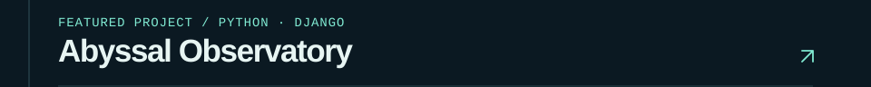
</picture></a>

<a href="https://dishank25.github.io/Dishank25/#about"><picture>
  <source media="(max-width: 600px)" srcset="https://raw.githubusercontent.com/Dishank25/Dishank25/main/assets/overview/about-360-0312d00e57.svg">
  <source media="(max-width: 1100px)" srcset="https://raw.githubusercontent.com/Dishank25/Dishank25/main/assets/overview/about-660-18b56f772c.svg">
  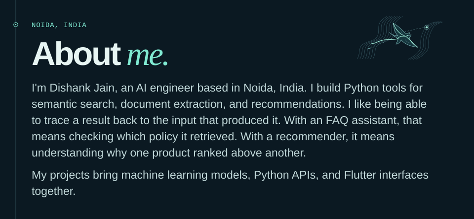
</picture></a>

<a href="https://dishank25.github.io/Dishank25/#work"><picture>
  <source media="(max-width: 600px)" srcset="https://raw.githubusercontent.com/Dishank25/Dishank25/main/assets/overview/selected-work-360-a2705c5f2c.svg">
  <source media="(max-width: 1100px)" srcset="https://raw.githubusercontent.com/Dishank25/Dishank25/main/assets/overview/selected-work-660-2c0168558f.svg">
  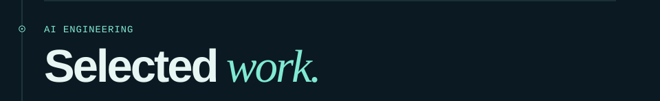
</picture></a>

<a href="https://dishank25.github.io/Dishank25/projects/pawsupport/"><picture>
  <source media="(max-width: 600px)" srcset="https://raw.githubusercontent.com/Dishank25/Dishank25/main/assets/overview/pawsupport-360-c8c21e07bc.svg">
  <source media="(max-width: 1100px)" srcset="https://raw.githubusercontent.com/Dishank25/Dishank25/main/assets/overview/pawsupport-660-3cb656a576.svg">
  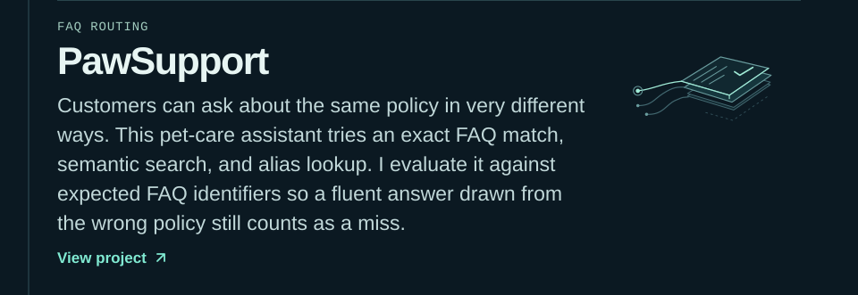
</picture></a>

<a href="https://dishank25.github.io/Dishank25/projects/supportpilot/"><picture>
  <source media="(max-width: 600px)" srcset="https://raw.githubusercontent.com/Dishank25/Dishank25/main/assets/overview/supportpilot-360-324e54131f.svg">
  <source media="(max-width: 1100px)" srcset="https://raw.githubusercontent.com/Dishank25/Dishank25/main/assets/overview/supportpilot-660-9db20f48e2.svg">
  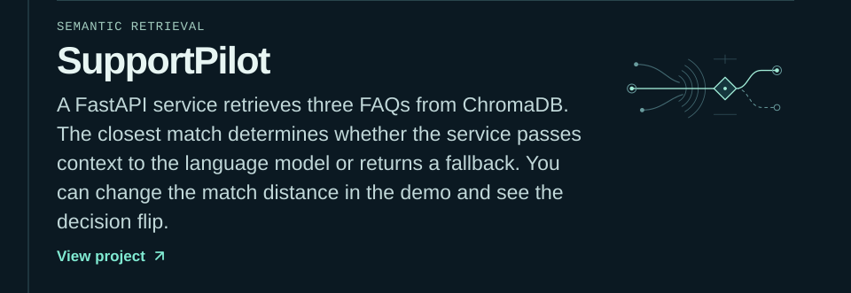
</picture></a>

<a href="https://dishank25.github.io/Dishank25/projects/veterinary-records/"><picture>
  <source media="(max-width: 600px)" srcset="https://raw.githubusercontent.com/Dishank25/Dishank25/main/assets/overview/veterinary-records-360-725c434851.svg">
  <source media="(max-width: 1100px)" srcset="https://raw.githubusercontent.com/Dishank25/Dishank25/main/assets/overview/veterinary-records-660-bcd41f5644.svg">
  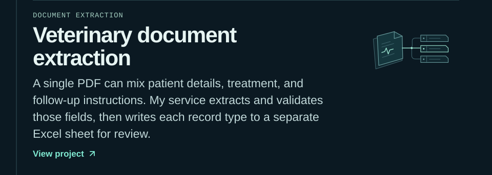
</picture></a>

<a href="https://dishank25.github.io/Dishank25/projects/recommendations/"><picture>
  <source media="(max-width: 600px)" srcset="https://raw.githubusercontent.com/Dishank25/Dishank25/main/assets/overview/recommendations-360-3e06c9495b.svg">
  <source media="(max-width: 1100px)" srcset="https://raw.githubusercontent.com/Dishank25/Dishank25/main/assets/overview/recommendations-660-b580f54e93.svg">
  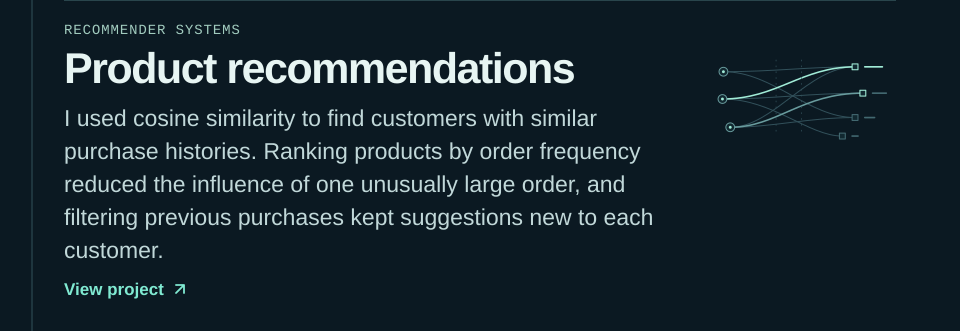
</picture></a>

<a href="https://dishank25.github.io/Dishank25/projects/breed-identification/"><picture>
  <source media="(max-width: 600px)" srcset="https://raw.githubusercontent.com/Dishank25/Dishank25/main/assets/overview/breed-identification-360-badf1f9910.svg">
  <source media="(max-width: 1100px)" srcset="https://raw.githubusercontent.com/Dishank25/Dishank25/main/assets/overview/breed-identification-660-3e80cc4e91.svg">
  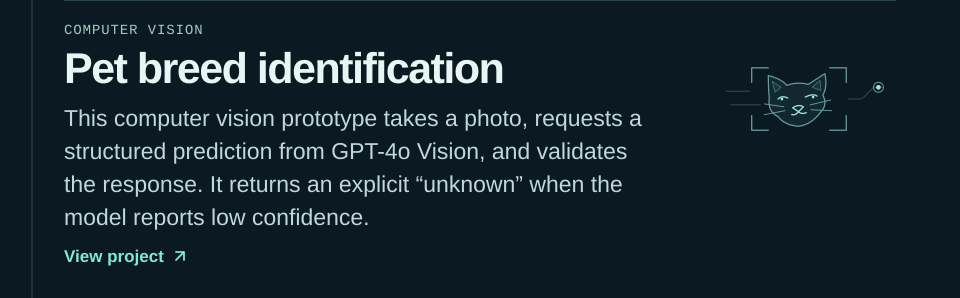
</picture></a>

<a href="https://dishank25.github.io/Dishank25/#work"><picture>
  <source media="(max-width: 600px)" srcset="https://raw.githubusercontent.com/Dishank25/Dishank25/main/assets/overview/more-projects-360-6956b11c08.svg">
  <source media="(max-width: 1100px)" srcset="https://raw.githubusercontent.com/Dishank25/Dishank25/main/assets/overview/more-projects-660-153f6897ce.svg">
  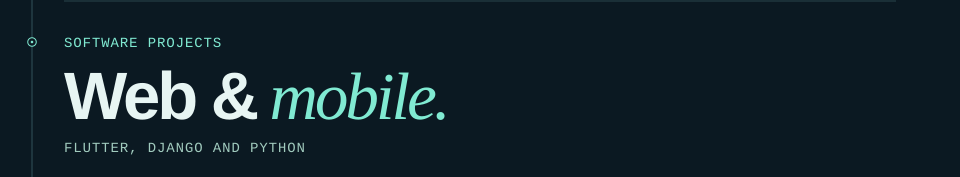
</picture></a>

<a href="https://dishank25.github.io/Dishank25/projects/abyssal-portfolio/"><picture>
  <source media="(max-width: 600px)" srcset="https://raw.githubusercontent.com/Dishank25/Dishank25/main/assets/overview/abyssal-portfolio-360-c5b5ecfba7.svg">
  <source media="(max-width: 1100px)" srcset="https://raw.githubusercontent.com/Dishank25/Dishank25/main/assets/overview/abyssal-portfolio-660-73edd62409.svg">
  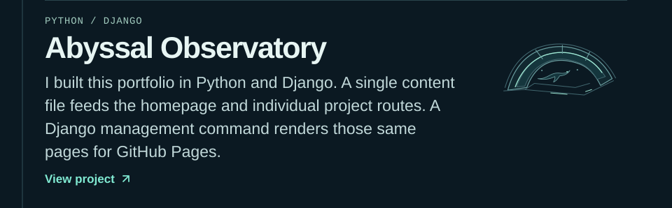
</picture></a>

<a href="https://dishank25.github.io/Dishank25/projects/job-portal/"><picture>
  <source media="(max-width: 600px)" srcset="https://raw.githubusercontent.com/Dishank25/Dishank25/main/assets/overview/job-portal-360-2fed0c690b.svg">
  <source media="(max-width: 1100px)" srcset="https://raw.githubusercontent.com/Dishank25/Dishank25/main/assets/overview/job-portal-660-fbc07633d1.svg">
  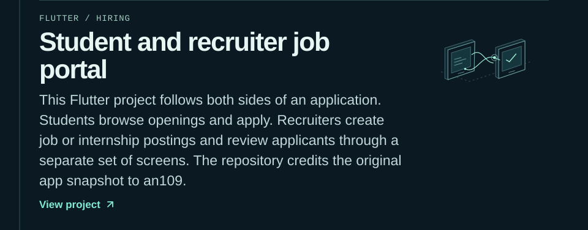
</picture></a>

<a href="https://dishank25.github.io/Dishank25/projects/job-discovery/"><picture>
  <source media="(max-width: 600px)" srcset="https://raw.githubusercontent.com/Dishank25/Dishank25/main/assets/overview/job-discovery-360-2a75800df9.svg">
  <source media="(max-width: 1100px)" srcset="https://raw.githubusercontent.com/Dishank25/Dishank25/main/assets/overview/job-discovery-660-30bdbff7ff.svg">
  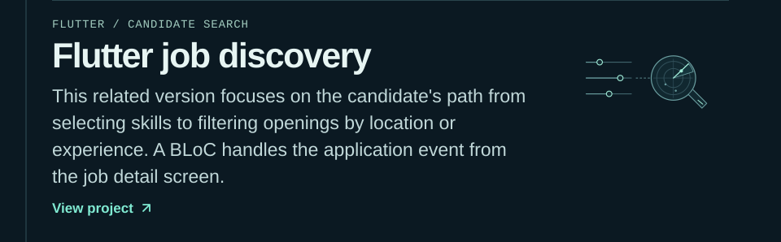
</picture></a>

<a href="https://dishank25.github.io/Dishank25/projects/terminal-tic-tac-toe/"><picture>
  <source media="(max-width: 600px)" srcset="https://raw.githubusercontent.com/Dishank25/Dishank25/main/assets/overview/terminal-tic-tac-toe-360-a2b7d40277.svg">
  <source media="(max-width: 1100px)" srcset="https://raw.githubusercontent.com/Dishank25/Dishank25/main/assets/overview/terminal-tic-tac-toe-660-bdca6de38d.svg">
  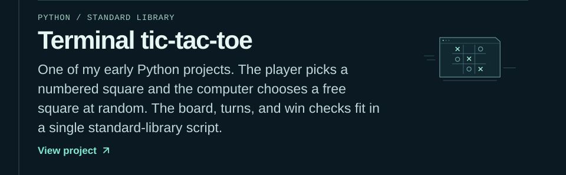
</picture></a>

<a href="https://dishank25.github.io/Dishank25/#skills"><picture>
  <source media="(max-width: 600px)" srcset="https://raw.githubusercontent.com/Dishank25/Dishank25/main/assets/overview/skills-360-77b9965258.svg">
  <source media="(max-width: 1100px)" srcset="https://raw.githubusercontent.com/Dishank25/Dishank25/main/assets/overview/skills-660-0e151dd287.svg">
  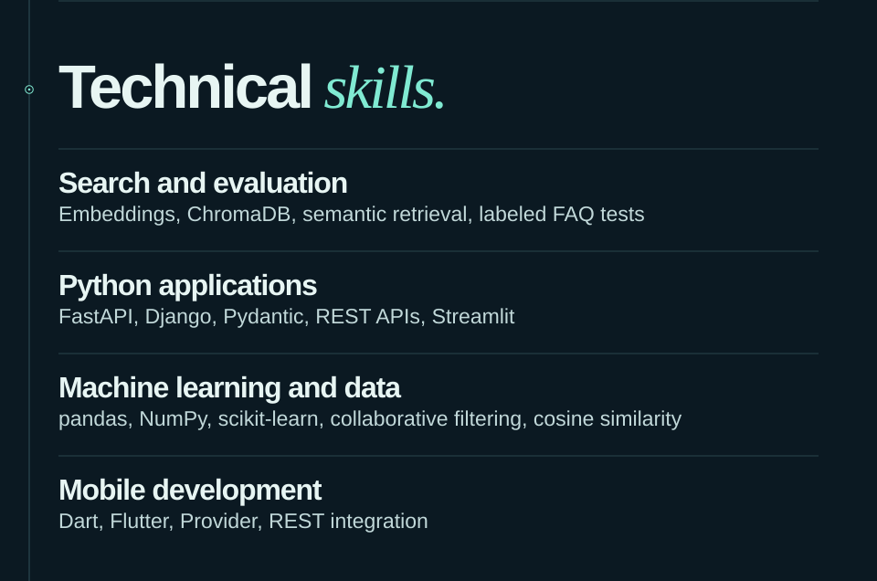
</picture></a>

<a href="https://dishank25.github.io/Dishank25/#experience"><picture>
  <source media="(max-width: 600px)" srcset="https://raw.githubusercontent.com/Dishank25/Dishank25/main/assets/overview/experience-360-45bcd01b30.svg">
  <source media="(max-width: 1100px)" srcset="https://raw.githubusercontent.com/Dishank25/Dishank25/main/assets/overview/experience-660-06c53311a3.svg">
  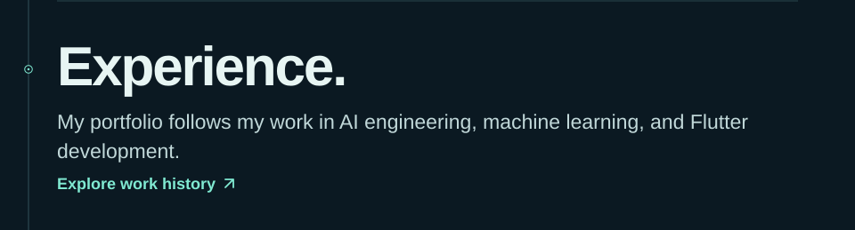
</picture></a>

<a href="https://dishank25.github.io/Dishank25/#experience"><picture>
  <source media="(max-width: 600px)" srcset="https://raw.githubusercontent.com/Dishank25/Dishank25/main/assets/overview/education-360-527cf360a8.svg">
  <source media="(max-width: 1100px)" srcset="https://raw.githubusercontent.com/Dishank25/Dishank25/main/assets/overview/education-660-70754da137.svg">
  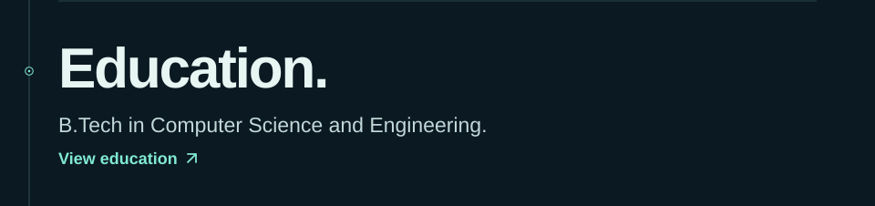
</picture></a>

<a href="https://www.linkedin.com/in/dishankjain25/"><picture>
  <source media="(max-width: 600px)" srcset="https://raw.githubusercontent.com/Dishank25/Dishank25/main/assets/overview/connect-360-5ed9f595a7.svg">
  <source media="(max-width: 1100px)" srcset="https://raw.githubusercontent.com/Dishank25/Dishank25/main/assets/overview/connect-660-920c2259e2.svg">
  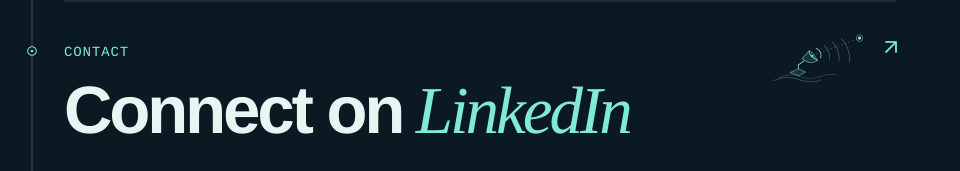
</picture></a>

<a href="https://github.com/Dishank25/Dishank25/blob/main/PROFILE.md"><picture>
  <source media="(max-width: 600px)" srcset="https://raw.githubusercontent.com/Dishank25/Dishank25/main/assets/overview/text-360-08403b85d1.svg">
  <source media="(max-width: 1100px)" srcset="https://raw.githubusercontent.com/Dishank25/Dishank25/main/assets/overview/text-660-03999e6a91.svg">
  
</picture></a>

