**[Enter the interactive observatory →](https://dishank25.github.io/Dishank25/)**

  <a href="https://dishank25.github.io/Dishank25/"><picture>
    <source media="(max-width: 600px)" srcset="https://raw.githubusercontent.com/Dishank25/Dishank25/887dc519585de16b22f7427b990c0b79fbab1a92/assets/observatory-mobile.svg" />
    
  </picture></a> 
  <a href="https://github.com/Dishank25/ZiglyPawSupport"><picture>
    <source media="(max-width: 600px)" srcset="https://raw.githubusercontent.com/Dishank25/Dishank25/887dc519585de16b22f7427b990c0b79fbab1a92/assets/pawsupport-mobile.svg" />
    
  </picture></a> 
  <a href="https://github.com/Dishank25/supportpilot"><picture>
    <source media="(max-width: 600px)" srcset="https://raw.githubusercontent.com/Dishank25/Dishank25/887dc519585de16b22f7427b990c0b79fbab1a92/assets/supportpilot-mobile.svg" />
    
  </picture></a> 
  <picture>
    <source media="(max-width: 600px)" srcset="https://raw.githubusercontent.com/Dishank25/Dishank25/887dc519585de16b22f7427b990c0b79fbab1a92/assets/instruments-mobile.svg" />
    
  </picture>

[PawSupport evaluation](https://github.com/Dishank25/ZiglyPawSupport/blob/main/evaluation/run_evaluation.py) · [SupportPilot retrieval code](https://github.com/Dishank25/supportpilot/blob/main/agents/retrieval_agent.py) · [Connect on LinkedIn](https://www.linkedin.com/in/dishankjain25/)

Text profile and more projects

I’m Dishank Jain, an AI engineer. I build Python applications for semantic search, document extraction, and product recommendations.

[PawSupport](https://github.com/Dishank25/ZiglyPawSupport) routes pet-care questions to approved FAQs. Its [labeled test cases](https://github.com/Dishank25/ZiglyPawSupport/blob/main/evaluation/test_cases_v1_strict.json) check whether a rephrased question still reaches the right source.

[SupportPilot](https://github.com/Dishank25/supportpilot) is a FastAPI service backed by ChromaDB. Its [chat endpoint](https://github.com/Dishank25/supportpilot/blob/main/main.py) retrieves three candidates and returns a fallback when the best match falls below its confidence threshold.

I use Python, FastAPI, Pydantic, ChromaDB, pandas, and scikit-learn. My other AI work includes extracting veterinary records from PDFs, recommending products from purchase histories, and prototyping pet breed identification.

Other public projects include a [Flutter job search app](https://github.com/Dishank25/rishabh6363-jobflutter-448f346c9d38), a [student and recruiter job portal](https://github.com/Dishank25/Job-Portal), and a [terminal tic-tac-toe game](https://github.com/Dishank25/python_project).

