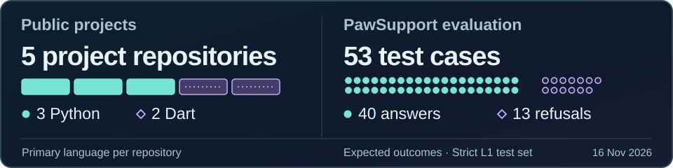

<picture>
  <source media="(prefers-reduced-motion: reduce)" srcset="assets/landscape-still.png">
  
</picture>

[Featured projects](#featured-projects) · [Public work](#public-work) · [LinkedIn](https://www.linkedin.com/in/dishankjain25/)

## Hi, I’m Dishank

<picture>
  <source media="(prefers-reduced-motion: reduce)" srcset="assets/retrieval-robot-still.png">
  
</picture>

I build Python applications for search, document extraction, and product recommendations. One question drives my retrieval work. When someone rephrases a support question, does the assistant still find the right source?

I test that with labeled questions and build fallbacks for cases where the evidence is weak. You can follow both decisions in the code below.

**I work with** · `Python` `FastAPI` `Pydantic` `ChromaDB` `pandas` `scikit-learn`

 

## Featured projects

### [PawSupport](https://github.com/Dishank25/ZiglyPawSupport)

A support question can arrive in a dozen different phrasings. PawSupport tries exact FAQ matching, semantic retrieval, and alias lookup. Its offline evaluation checks the selected FAQ ID, so a fluent reply drawn from the wrong source still fails.

[Read the evaluation code →](https://github.com/Dishank25/ZiglyPawSupport/blob/main/evaluation/run_evaluation.py) · [Explore the test cases →](https://github.com/Dishank25/ZiglyPawSupport/blob/main/evaluation/test_cases_v1_strict.json)

### [SupportPilot](https://github.com/Dishank25/supportpilot)

Each request enters a FastAPI chat endpoint. The service identifies the intent, retrieves three candidates from ChromaDB, and uses the match score to decide whether it has enough evidence to answer.

[Follow a request through the API →](https://github.com/Dishank25/supportpilot/blob/main/main.py)

## Public work

<strong>Explore the other three repositories</strong>

| Project | What you can explore |
| --- | --- |
| [Job discovery in Flutter](https://github.com/Dishank25/rishabh6363-jobflutter-448f346c9d38) | Follow a listing from search filters and job details to the application flow. |
| [Job Portal](https://github.com/Dishank25/Job-Portal) | See the related Flutter app from both sides of hiring, with separate student and recruiter screens. |
| [Tic-tac-toe in Python](https://github.com/Dishank25/python_project) | Play a terminal game against a computer opponent that chooses an empty square at random. |

<strong>More engineering work and technical skills</strong>

- **Document extraction.** Built a FastAPI service that extracts pet, treatment, and follow-up records from veterinary PDFs, validates the fields, and writes them to separate Excel sheets.
- **Product recommendations.** Used cosine similarity to find customers with similar purchase histories, ranked products by purchase frequency, and excluded items the customer had already bought.
- **Vision prototype.** Built a GPT-4o Vision prototype that validates the image and JSON response and returns an unknown result for low-confidence predictions.
- **Technical skills.** Semantic search, retrieval-augmented generation, embeddings, offline evaluation, REST APIs, collaborative filtering, NumPy, and Git.

