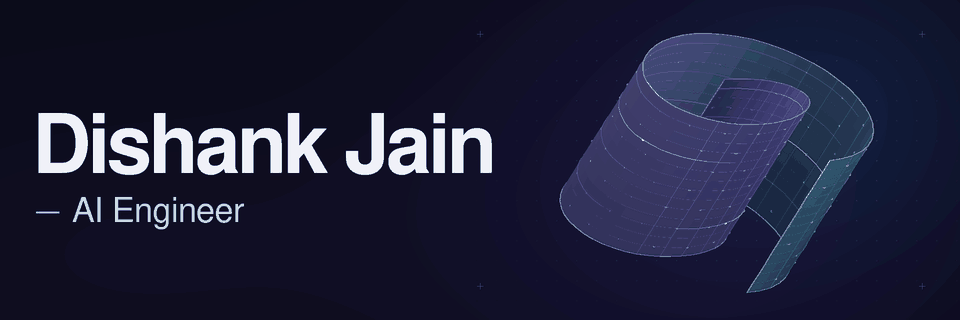

<picture>
  <source media="(prefers-reduced-motion: reduce)" srcset="assets/profile-still.png">
  
</picture>

I build Python applications that find answers in a knowledge base, turn documents into structured records, and recommend products from purchase history. In my retrieval work, I test which source the system chose before I judge the answer it wrote.

[Featured projects](#featured-projects) · [Technical skills](#technical-skills) · [More repositories](#more-repositories) · [Connect on LinkedIn](https://www.linkedin.com/in/dishankjain25/)

## Featured projects

### [PawSupport](https://github.com/Dishank25/ZiglyPawSupport)

A customer can ask the same question in a dozen ways. I built a support assistant that routes those variations to a curated FAQ and an offline evaluation that checks the selected FAQ ID. A well-written reply still fails the test if it came from the wrong source.

[Read the evaluation code →](https://github.com/Dishank25/ZiglyPawSupport/blob/main/evaluation/run_evaluation.py)

### [SupportPilot](https://github.com/Dishank25/supportpilot)

When should a support assistant answer? I built a FastAPI service that retrieves three candidates from ChromaDB and returns a fallback when the best match is too weak. You can follow a request from the `/chat` endpoint through that decision.

[Trace a chat request →](https://github.com/Dishank25/supportpilot/blob/main/main.py)

## Technical skills

- **AI and retrieval** · Embeddings, semantic search, retrieval-augmented generation, offline evaluation
- **Python and APIs** · Python, FastAPI, Pydantic, ChromaDB, Git
- **Data and machine learning** · pandas, NumPy, scikit-learn, collaborative filtering

<strong>More engineering work</strong> · Document extraction, recommendations, and vision

- **Veterinary document extraction.** Built a FastAPI service that extracts pet, treatment, and follow-up records from PDFs, validates the fields, and writes them to separate Excel sheets.
- **Product recommendations.** Used cosine similarity to find customers with similar purchase histories, then ranked products by purchase frequency and excluded items each customer had already bought.
- **Pet breed identification.** Built a GPT-4o Vision prototype that checks the uploaded image, validates the JSON response, and returns an unknown result when confidence is low.

## More repositories

| Project | Explore |
| --- | --- |
| [Job discovery in Flutter](https://github.com/Dishank25/rishabh6363-jobflutter-448f346c9d38) | Follow a listing from search filters and job details to the application flow. |
| [Job Portal](https://github.com/Dishank25/Job-Portal) | Explore the related Flutter app from both sides of hiring, with separate student and recruiter screens. |
| [Tic-tac-toe in Python](https://github.com/Dishank25/python_project) | Play a terminal game against a computer opponent that chooses an empty square at random. |
