
<a href="https://dishank25.github.io/Dishank25/"><picture>
  <source media="(max-width: 600px)" srcset="https://raw.githubusercontent.com/Dishank25/Dishank25/2a100f4d9834131c5c129b0d8cfeea1d2d21182d/assets/observatory-breathing-mobile.svg">
  
</picture></a>

<a href="https://dishank25.github.io/Dishank25/projects/abyssal-portfolio/"><picture><source media="(max-width: 440px)" srcset="https://raw.githubusercontent.com/Dishank25/Dishank25/main/assets/overview/featured-360-35a9e4fe14.svg"><source media="(max-width: 600px)" srcset="https://raw.githubusercontent.com/Dishank25/Dishank25/main/assets/overview/featured-475-2b7f9b8030.svg"><source media="(max-width: 1023px)" srcset="https://raw.githubusercontent.com/Dishank25/Dishank25/main/assets/overview/featured-660-2ebd290e5d.svg"><source media="(max-width: 1199px)" srcset="https://raw.githubusercontent.com/Dishank25/Dishank25/main/assets/overview/featured-800-984f13542a.svg">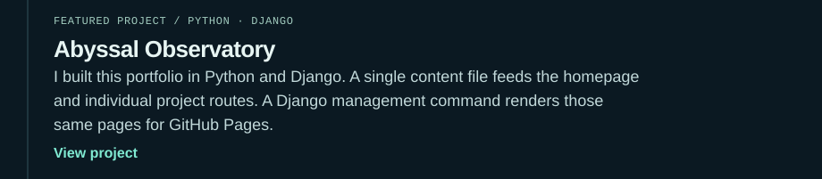</picture></a>

<a href="https://dishank25.github.io/Dishank25/#about"><picture><source media="(max-width: 440px)" srcset="https://raw.githubusercontent.com/Dishank25/Dishank25/main/assets/overview/about-360-969610a129.svg"><source media="(max-width: 600px)" srcset="https://raw.githubusercontent.com/Dishank25/Dishank25/main/assets/overview/about-475-e46a623735.svg"><source media="(max-width: 1023px)" srcset="https://raw.githubusercontent.com/Dishank25/Dishank25/main/assets/overview/about-660-5cf2c9c432.svg"><source media="(max-width: 1199px)" srcset="https://raw.githubusercontent.com/Dishank25/Dishank25/main/assets/overview/about-800-6a0aeb8ff0.svg">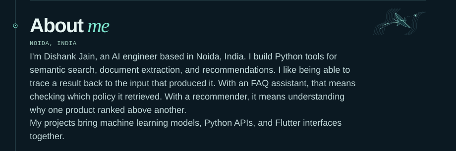</picture></a>

<a href="https://dishank25.github.io/Dishank25/#work"><picture><source media="(max-width: 440px)" srcset="https://raw.githubusercontent.com/Dishank25/Dishank25/main/assets/overview/my-works-360-ceff72f1bf.svg"><source media="(max-width: 600px)" srcset="https://raw.githubusercontent.com/Dishank25/Dishank25/main/assets/overview/my-works-475-04958a22a9.svg"><source media="(max-width: 1023px)" srcset="https://raw.githubusercontent.com/Dishank25/Dishank25/main/assets/overview/my-works-660-a7c8a49476.svg"><source media="(max-width: 1199px)" srcset="https://raw.githubusercontent.com/Dishank25/Dishank25/main/assets/overview/my-works-800-410ee58588.svg"></picture></a>

<a href="https://dishank25.github.io/Dishank25/projects/pawsupport/"><picture><source media="(max-width: 1023px)" srcset="https://raw.githubusercontent.com/Dishank25/Dishank25/main/assets/overview/inline-layout.svg" width="0" height="0"><source media="(max-width: 1199px)" srcset="https://raw.githubusercontent.com/Dishank25/Dishank25/main/assets/overview/pawsupport-800-column-f484ecabe9.svg">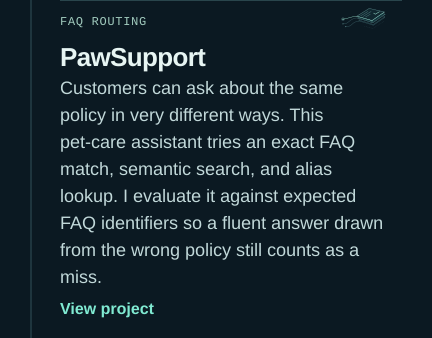</picture><picture><source media="(max-width: 440px)" srcset="https://raw.githubusercontent.com/Dishank25/Dishank25/main/assets/overview/pawsupport-360-stack-acf9e19200.svg"><source media="(max-width: 600px)" srcset="https://raw.githubusercontent.com/Dishank25/Dishank25/main/assets/overview/pawsupport-475-stack-0c47a60ffd.svg"><source media="(max-width: 1023px)" srcset="https://raw.githubusercontent.com/Dishank25/Dishank25/main/assets/overview/pawsupport-660-stack-beefe86c72.svg"></picture></a><a href="https://dishank25.github.io/Dishank25/projects/supportpilot/"><picture><source media="(max-width: 1023px)" srcset="https://raw.githubusercontent.com/Dishank25/Dishank25/main/assets/overview/inline-layout.svg" width="0" height="0"><source media="(max-width: 1199px)" srcset="https://raw.githubusercontent.com/Dishank25/Dishank25/main/assets/overview/supportpilot-800-column-1007d734ab.svg">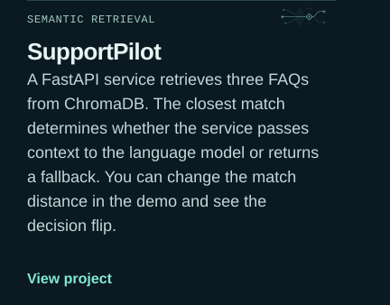</picture><picture><source media="(max-width: 440px)" srcset="https://raw.githubusercontent.com/Dishank25/Dishank25/main/assets/overview/supportpilot-360-stack-9c533938f5.svg"><source media="(max-width: 600px)" srcset="https://raw.githubusercontent.com/Dishank25/Dishank25/main/assets/overview/supportpilot-475-stack-95397972a7.svg"><source media="(max-width: 1023px)" srcset="https://raw.githubusercontent.com/Dishank25/Dishank25/main/assets/overview/supportpilot-660-stack-72fd6e97b1.svg"></picture></a>

<a href="https://dishank25.github.io/Dishank25/projects/veterinary-records/"><picture><source media="(max-width: 1023px)" srcset="https://raw.githubusercontent.com/Dishank25/Dishank25/main/assets/overview/inline-layout.svg" width="0" height="0"><source media="(max-width: 1199px)" srcset="https://raw.githubusercontent.com/Dishank25/Dishank25/main/assets/overview/veterinary-records-800-column-20e8910f58.svg">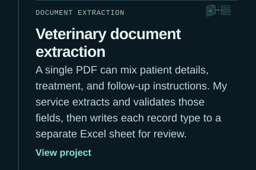</picture><picture><source media="(max-width: 440px)" srcset="https://raw.githubusercontent.com/Dishank25/Dishank25/main/assets/overview/veterinary-records-360-stack-d3714bac9d.svg"><source media="(max-width: 600px)" srcset="https://raw.githubusercontent.com/Dishank25/Dishank25/main/assets/overview/veterinary-records-475-stack-2e0c8e16d0.svg"><source media="(max-width: 1023px)" srcset="https://raw.githubusercontent.com/Dishank25/Dishank25/main/assets/overview/veterinary-records-660-stack-679fb87a0c.svg"></picture></a><a href="https://dishank25.github.io/Dishank25/projects/recommendations/"><picture><source media="(max-width: 1023px)" srcset="https://raw.githubusercontent.com/Dishank25/Dishank25/main/assets/overview/inline-layout.svg" width="0" height="0"><source media="(max-width: 1199px)" srcset="https://raw.githubusercontent.com/Dishank25/Dishank25/main/assets/overview/recommendations-800-column-50be69944c.svg">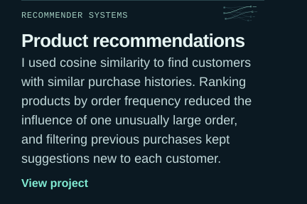</picture><picture><source media="(max-width: 440px)" srcset="https://raw.githubusercontent.com/Dishank25/Dishank25/main/assets/overview/recommendations-360-stack-d8299c29ac.svg"><source media="(max-width: 600px)" srcset="https://raw.githubusercontent.com/Dishank25/Dishank25/main/assets/overview/recommendations-475-stack-9e70ac2044.svg"><source media="(max-width: 1023px)" srcset="https://raw.githubusercontent.com/Dishank25/Dishank25/main/assets/overview/recommendations-660-stack-2ef4d6d67b.svg"></picture></a>

<a href="https://dishank25.github.io/Dishank25/projects/breed-identification/"><picture><source media="(max-width: 1023px)" srcset="https://raw.githubusercontent.com/Dishank25/Dishank25/main/assets/overview/inline-layout.svg" width="0" height="0"><source media="(max-width: 1199px)" srcset="https://raw.githubusercontent.com/Dishank25/Dishank25/main/assets/overview/breed-identification-800-column-8660765d1e.svg">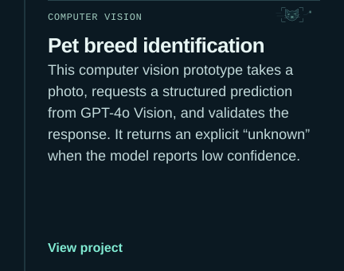</picture><picture><source media="(max-width: 440px)" srcset="https://raw.githubusercontent.com/Dishank25/Dishank25/main/assets/overview/breed-identification-360-stack-0b80003672.svg"><source media="(max-width: 600px)" srcset="https://raw.githubusercontent.com/Dishank25/Dishank25/main/assets/overview/breed-identification-475-stack-2dd85d5c80.svg"><source media="(max-width: 1023px)" srcset="https://raw.githubusercontent.com/Dishank25/Dishank25/main/assets/overview/breed-identification-660-stack-613d64589b.svg"></picture></a><a href="https://dishank25.github.io/Dishank25/projects/job-portal/"><picture><source media="(max-width: 1023px)" srcset="https://raw.githubusercontent.com/Dishank25/Dishank25/main/assets/overview/inline-layout.svg" width="0" height="0"><source media="(max-width: 1199px)" srcset="https://raw.githubusercontent.com/Dishank25/Dishank25/main/assets/overview/job-portal-800-column-2eba8a0eef.svg">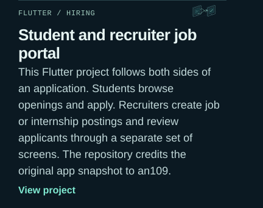</picture><picture><source media="(max-width: 440px)" srcset="https://raw.githubusercontent.com/Dishank25/Dishank25/main/assets/overview/job-portal-360-stack-b402dbdb88.svg"><source media="(max-width: 600px)" srcset="https://raw.githubusercontent.com/Dishank25/Dishank25/main/assets/overview/job-portal-475-stack-3222af0662.svg"><source media="(max-width: 1023px)" srcset="https://raw.githubusercontent.com/Dishank25/Dishank25/main/assets/overview/job-portal-660-stack-0327ed1985.svg"></picture></a>

<a href="https://dishank25.github.io/Dishank25/projects/job-discovery/"><picture><source media="(max-width: 1023px)" srcset="https://raw.githubusercontent.com/Dishank25/Dishank25/main/assets/overview/inline-layout.svg" width="0" height="0"><source media="(max-width: 1199px)" srcset="https://raw.githubusercontent.com/Dishank25/Dishank25/main/assets/overview/job-discovery-800-column-d590bf47e0.svg">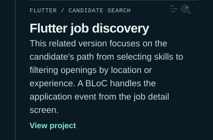</picture><picture><source media="(max-width: 440px)" srcset="https://raw.githubusercontent.com/Dishank25/Dishank25/main/assets/overview/job-discovery-360-stack-da8b893d81.svg"><source media="(max-width: 600px)" srcset="https://raw.githubusercontent.com/Dishank25/Dishank25/main/assets/overview/job-discovery-475-stack-a409f79cfe.svg"><source media="(max-width: 1023px)" srcset="https://raw.githubusercontent.com/Dishank25/Dishank25/main/assets/overview/job-discovery-660-stack-eef95d1a0b.svg"></picture></a><a href="https://dishank25.github.io/Dishank25/projects/terminal-tic-tac-toe/"><picture><source media="(max-width: 1023px)" srcset="https://raw.githubusercontent.com/Dishank25/Dishank25/main/assets/overview/inline-layout.svg" width="0" height="0"><source media="(max-width: 1199px)" srcset="https://raw.githubusercontent.com/Dishank25/Dishank25/main/assets/overview/terminal-tic-tac-toe-800-column-80148ce1f6.svg">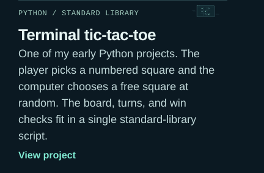</picture><picture><source media="(max-width: 440px)" srcset="https://raw.githubusercontent.com/Dishank25/Dishank25/main/assets/overview/terminal-tic-tac-toe-360-stack-76212a2704.svg"><source media="(max-width: 600px)" srcset="https://raw.githubusercontent.com/Dishank25/Dishank25/main/assets/overview/terminal-tic-tac-toe-475-stack-49a49dd6e1.svg"><source media="(max-width: 1023px)" srcset="https://raw.githubusercontent.com/Dishank25/Dishank25/main/assets/overview/terminal-tic-tac-toe-660-stack-6d7c0bb4f7.svg"></picture></a>

<a href="https://dishank25.github.io/Dishank25/#skills"><picture><source media="(max-width: 440px)" srcset="https://raw.githubusercontent.com/Dishank25/Dishank25/main/assets/overview/skills-360-7577ee2b7c.svg"><source media="(max-width: 600px)" srcset="https://raw.githubusercontent.com/Dishank25/Dishank25/main/assets/overview/skills-475-ae764c2439.svg"><source media="(max-width: 1023px)" srcset="https://raw.githubusercontent.com/Dishank25/Dishank25/main/assets/overview/skills-660-1e86824808.svg"><source media="(max-width: 1199px)" srcset="https://raw.githubusercontent.com/Dishank25/Dishank25/main/assets/overview/skills-800-a3f0614c0a.svg">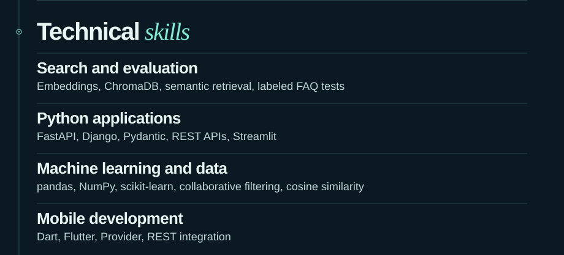</picture></a>

<a href="https://dishank25.github.io/Dishank25/#experience"><picture><source media="(max-width: 440px)" srcset="https://raw.githubusercontent.com/Dishank25/Dishank25/main/assets/overview/experience-360-e32f5a39e5.svg"><source media="(max-width: 600px)" srcset="https://raw.githubusercontent.com/Dishank25/Dishank25/main/assets/overview/experience-475-b032534f4f.svg"><source media="(max-width: 1023px)" srcset="https://raw.githubusercontent.com/Dishank25/Dishank25/main/assets/overview/experience-660-511da3ad03.svg"><source media="(max-width: 1199px)" srcset="https://raw.githubusercontent.com/Dishank25/Dishank25/main/assets/overview/experience-800-80f291cda7.svg">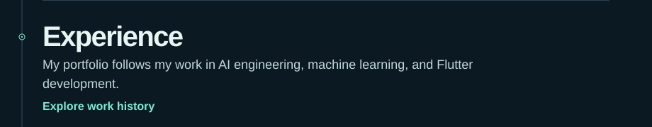</picture></a>

<a href="https://dishank25.github.io/Dishank25/#experience"><picture><source media="(max-width: 440px)" srcset="https://raw.githubusercontent.com/Dishank25/Dishank25/main/assets/overview/education-360-b279581ff7.svg"><source media="(max-width: 600px)" srcset="https://raw.githubusercontent.com/Dishank25/Dishank25/main/assets/overview/education-475-966cc79228.svg"><source media="(max-width: 1023px)" srcset="https://raw.githubusercontent.com/Dishank25/Dishank25/main/assets/overview/education-660-fbacf962da.svg"><source media="(max-width: 1199px)" srcset="https://raw.githubusercontent.com/Dishank25/Dishank25/main/assets/overview/education-800-ce958ebf6d.svg"></picture></a>

<a href="https://www.linkedin.com/in/dishankjain25/"><picture><source media="(max-width: 440px)" srcset="https://raw.githubusercontent.com/Dishank25/Dishank25/main/assets/overview/connect-360-9e79665f03.svg"><source media="(max-width: 600px)" srcset="https://raw.githubusercontent.com/Dishank25/Dishank25/main/assets/overview/connect-475-5800b3b6cf.svg"><source media="(max-width: 1023px)" srcset="https://raw.githubusercontent.com/Dishank25/Dishank25/main/assets/overview/connect-660-f568dd7839.svg"><source media="(max-width: 1199px)" srcset="https://raw.githubusercontent.com/Dishank25/Dishank25/main/assets/overview/connect-800-ee36272036.svg"></picture></a>

<a href="https://github.com/Dishank25/Dishank25/blob/main/PROFILE.md"><picture><source media="(max-width: 440px)" srcset="https://raw.githubusercontent.com/Dishank25/Dishank25/main/assets/overview/text-360-0b408c2d9f.svg"><source media="(max-width: 600px)" srcset="https://raw.githubusercontent.com/Dishank25/Dishank25/main/assets/overview/text-475-8f51274164.svg"><source media="(max-width: 1023px)" srcset="https://raw.githubusercontent.com/Dishank25/Dishank25/main/assets/overview/text-660-09c9cc2d5e.svg"><source media="(max-width: 1199px)" srcset="https://raw.githubusercontent.com/Dishank25/Dishank25/main/assets/overview/text-800-edf1a23432.svg"></picture></a>

